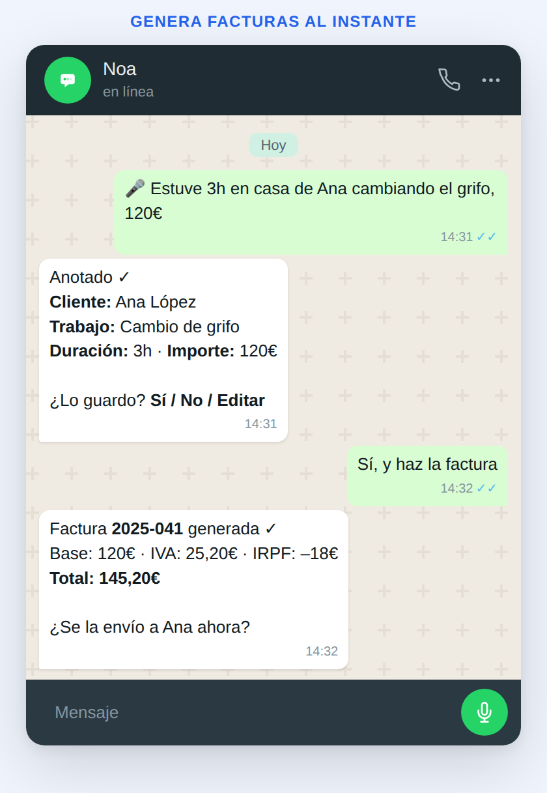
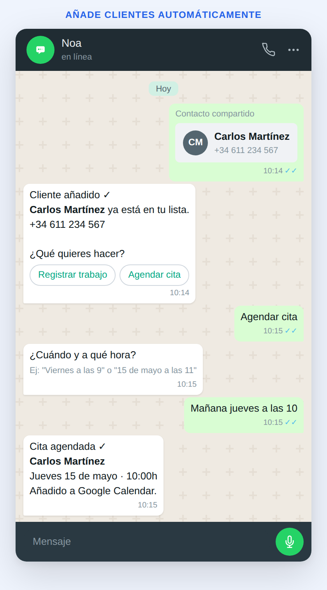
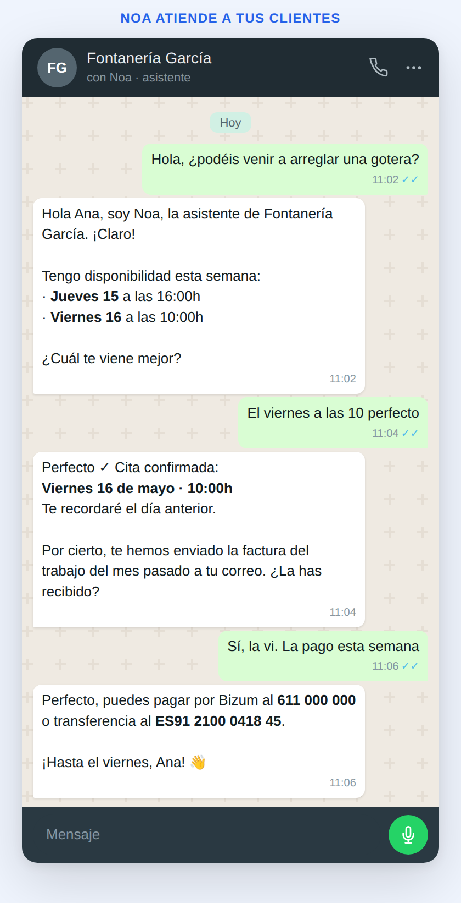

<p align="center">
  <picture>
    <source media="(prefers-color-scheme: dark)" srcset="noa_knowledge/brand/noa-lockup-dark.svg">
    
  </picture>
</p>

<h3 align="center">Tu negocio, gestionado por <em>voz</em></h3>

<p align="center">
  An AI assistant for Spanish independent contractors (<em>autónomos</em>) that lives entirely in WhatsApp and Telegram.<br>
  Dictate what you did, get a legal invoice, and get paid — no app, no paperwork.
</p>

---

> **Status:** Noa is no longer offered as a hosted service. The code is published as open source so anyone can study it, self-host it or build on it.

Plumbers, electricians, builders, painters and handymen spend their evenings on invoices instead of with their families. Noa lets them talk to an assistant the same way they talk to a client: send a voice note or a text, and Noa extracts the client, job, hours and amount, generates a tax-compliant invoice, sends it to the client and chases payment.

## See it in action

<table>
  <tr>
    <td align="center" width="33%"></td>
    <td align="center" width="33%"></td>
    <td align="center" width="33%"></td>
  </tr>
  <tr>
    <td align="center"><b>Instant invoices</b><br>A voice note becomes a legal invoice.</td>
    <td align="center"><b>Automatic client list</b><br>Share a contact, book a job.</td>
    <td align="center"><b>Noa talks to your clients</b><br>Bookings, reminders and payments.</td>
  </tr>
</table>

## How it works

1. **Tell Noa what you did.** Send a voice note or text from WhatsApp or Telegram. Noa extracts the client, job, hours and amount.
2. **Noa generates the legal invoice.** A PDF with sequential numbering, IVA, IRPF and an SII-compatible format — no invoicing software involved.
3. **It sends it to your client.** Straight to the client's WhatsApp. If they don't pay on time, Noa sends the reminder for you.
4. **Quarterly close without surprises.** A spreadsheet ready for *modelo 303* and *modelo 130*, with deadline reminders.

## Features

| | |
|---|---|
| **Clients and jobs** | Every job is stored with date, duration and amount. Look up any client's history in seconds. |
| **Built-in calendar** | "Cita con Pepe el jueves a las 10" → a Google Calendar event. Noa also negotiates availability with clients. |
| **Payments and reminders** | Noa detects unpaid invoices and sends automatic reminders to clients on the contractor's behalf. |
| **Quarterly tax summary** | Income and expenses broken down for *modelo 303* and *130*. |
| **Professional quotes** | Create a budget by voice and send it as a PDF. If the client accepts, turn it into an invoice with one message. |
| **Bot for your clients** | Clients write to the same number. Noa books appointments, sends quotes and handles payments without interrupting the contractor. |

### Plans (as offered at launch)

| Autónomo — 19 €/month | Pro — 39 €/month |
|---|---|
| Unlimited invoices and quotes | Everything in Autónomo |
| Google Calendar scheduling | Bot for clients (bookings, payments) |
| Client history | Automatic payment reminders |
| Quarterly tax summary | Automatic Google Maps review requests |
| Chat support | Priority support |

## Tech stack

- **API:** FastAPI (Python 3.12)
- **Database:** PostgreSQL via async SQLAlchemy + Alembic migrations
- **AI:** Claude API for conversation and tool use; Whisper-compatible API for voice transcription
- **Messaging:** Telegram Bot API and WhatsApp Business (Meta Cloud API)
- **Storage:** S3-compatible object storage (Scaleway; MinIO locally)
- **Calendar:** Google Calendar via a pluggable `CalendarProvider` protocol
- **PDF:** SII-compatible invoice and budget generation
- **Infrastructure:** Terraform on Scaleway — see [`infra/README.md`](infra/README.md)

Design notes live in [`noa_knowledge/`](noa_knowledge/): product overview, AI architecture, data model, conversation design and architecture decision records.

## Project structure

```
app/
  api/          # FastAPI routers (webhooks, admin)
  services/     # Business logic (invoice, job, calendar, session)
  ai/           # Claude integration (session assembly, tool handlers)
  models/       # SQLAlchemy ORM models
  schemas/      # Pydantic schemas
  storage/      # S3 client
  calendar/     # CalendarProvider protocol + GoogleCalendarProvider
  pdf/          # Invoice and budget PDF generation
alembic/        # Database migrations
infra/          # Terraform + deploy scripts
tests/          # Unit and integration tests
```

## Running locally

```bash
cp .env.example .env            # fill in your own API keys
python -m venv .venv && .venv/bin/pip install -e ".[dev]"
docker compose up -d            # PostgreSQL, Redis and MinIO
.venv/bin/alembic upgrade head
.venv/bin/uvicorn app.main:app --reload
```

To talk to your own Telegram bot locally, expose the server (e.g. with ngrok) and register the webhook with `scripts/set_webhook.sh <public-url>`. You can also simulate inbound messages with `scripts/simulate_message.py`.

## Tests

```bash
.venv/bin/pytest tests/unit/
.venv/bin/pytest tests/integration/   # needs `docker compose up -d`
```

Integration tests run against a real PostgreSQL instance.

## License

Licensed under either of

- Apache License, Version 2.0 ([LICENSE-APACHE](LICENSE-APACHE) or <https://www.apache.org/licenses/LICENSE-2.0>)
- MIT license ([LICENSE-MIT](LICENSE-MIT) or <https://opensource.org/licenses/MIT>)

at your option.

Unless you explicitly state otherwise, any contribution intentionally submitted
for inclusion in this work by you, as defined in the Apache-2.0 license, shall
be dual licensed as above, without any additional terms or conditions.
